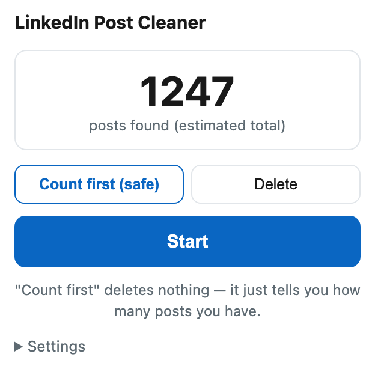

# LinkedIn Post Cleaner

**Delete all your LinkedIn posts — and actually reach the end of the list.**

Every other tool stops at ~500 posts and tells you it's done.
This one reloads the page and keeps going, because that is the only thing that works.

<!-- Swap for docs/demo.gif once the screen recording is in. -->

Count first mode — nothing is deleted until you switch modes yourself.

---

## The problem

You want a clean profile. LinkedIn gives you no bulk delete — one post, three
clicks, a confirmation modal, a thousand times over.

So you find a script. It runs, it deletes a few hundred posts, it says **done**.
You refresh your profile and hundreds of posts are still sitting there.

The script wasn't lying. **LinkedIn's activity feed stops serving new items after
roughly 400–500.** Scroll all you want; nothing more arrives. Anything watching
the page correctly concludes there is nothing left.

Measured on a real account: the page reported **37 posts left**. After a reload,
**481** were still there.

## The fix

Reload the page and continue. That sounds trivial until you notice what it costs:
**a reload kills the script doing the work.** A snippet pasted into the DevTools
console cannot survive its own page refresh — which is why every console-snippet
tool on the internet has this bug.

That is the whole reason this is an extension. Progress lives in
`chrome.storage`, the tab reloads itself every 50 posts, and the content script
picks up where it left off on every page load.

**Proven on a live account: 1,200+ posts deleted in a single night.**

## Install

Not on the Chrome Web Store yet. Takes about 30 seconds:

1. **[Download the ZIP](../../archive/refs/heads/main.zip)** and unzip it.
2. Open `chrome://extensions` (Brave: `brave://extensions`, Edge: `edge://extensions`).
3. Turn on **Developer mode**, top right.
4. Click **Load unpacked** and pick the unzipped folder.

Works in Chrome, Brave, Edge and any other Chromium browser.

## Use

1. Go to your own activity page: `linkedin.com/in/<you>/recent-activity/all/`
2. Click the extension icon.
3. Leave it on **Count first** and press **Start**. Nothing is deleted — it only
   tells you how many posts are really there.
4. If the number looks right, switch to **Delete** and press **Start** again.

The tab reloads itself every 50 posts. That is intentional — don't close it.
**Stop** takes effect on the next post.

Speed is **8–11 seconds per post**. A thousand posts takes a couple of hours.
The delay is deliberate: hammering the site is both rude and a fast way to get
rate-limited.

> [!WARNING]
> **Deletion is permanent.** LinkedIn has no trash bin and no undo.
> If you might want the text later, export first:
> Settings → Data privacy → *Get a copy of your data*.

## How it compares

| | Typical tool | This one |
|---|---|---|
| Reloads to refill the feed | ✗ | ✓ every N posts (default 50) |
| Survives a page reload | ✗ | ✓ state in `chrome.storage` |
| Non-English LinkedIn | ✗ matches the word "Delete" | ✓ language-independent CSS selectors, text only as fallback |
| Dry run | sometimes | ✓ **on by default** — counts before it destroys anything |
| Counts before deleting | ✗ | ✓ reads LinkedIn's own render index, which survives DOM recycling |
| Stop button | sometimes | ✓ takes effect on the next post |

The language point matters more than it sounds. A tool that looks for the literal
string `"Delete"` deletes exactly **zero** posts on a Turkish, German or Spanish
LinkedIn. This one keys off `li.option-delete`, which is identical in every
language, and falls back to text only if that class ever changes.

## Counting without touching anything

Counting the cards on the page undercounts badly. LinkedIn recycles them: it
throws old cards out of the DOM as you scroll, so however far you go the page
holds only a few hundred at a time.

The hidden label on each card does not get recycled. LinkedIn stamps every card
it renders with *"Feed post number N"*, and N keeps climbing for as long as the
page stays open. On a real account the DOM held **452** cards while the labels
had already reached **965** — the labels remembered what the DOM had forgotten.

So **Count first** scrolls to the bottom, waits until the highest N stops
growing, and reports it. It is an estimate, not a guarantee: N counts what
LinkedIn has actually served this page, and if the feed stops feeding — see above
— the real total can be higher. Nothing is clicked and nothing is deleted, so
running it first costs you nothing.

## Privacy

No servers, no analytics, no network requests of its own. Nothing leaves your
browser. Permissions are `storage` (to remember progress across reloads) and
`tabs` (to reload the activity page), scoped to `linkedin.com` only.

This automates clicks in your own browser, on your own account, through the
normal UI. It does not touch anyone else's content and does not call LinkedIn's
internal APIs. Even so, LinkedIn's User Agreement does not permit automated
tools — you use this at your own risk, on your own account.

## Status

- **The deletion engine is proven.** The selectors and click sequence in
  `content.js` are the ones that deleted 1,200+ real posts in one night on a live
  account. The reload-every-N behaviour and the "three empty rounds means
  finished" rule both come from that run.
- **The extension shell is younger than the engine.** The popup, the
  `chrome.storage` state and the resume-after-reload path have had far less
  mileage. If something misbehaves, it will be here rather than in the deleting.
- Always run **Count first** before **Delete**. It touches nothing, and it tells
  you whether the extension can see your posts at all.

## How it works

- **`content.js`** — finds each post's "…" button, opens the menu, clicks the
  delete row, confirms in the modal, repeats. Every N posts it saves state and
  reloads. On load it checks whether a run is in progress and resumes. When the
  page comes up empty it reloads and looks again; only after three empty rounds
  does it declare the job finished.
- **`popup.js`** — settings and progress. State is a single object in
  `chrome.storage.local`, so the popup and the page always agree.

## When it breaks

LinkedIn changes its markup from time to time and that will eventually break
this. The selectors to look at are `MENU_SECICI`, `silSatiri()` and
`onayDugmesi()` in `content.js` — all three try a stable CSS class first and fall
back to text.

Open an issue with your browser, your LinkedIn interface language, and what the
popup showed. Pull requests welcome — see [CONTRIBUTING.md](CONTRIBUTING.md).

---

MIT licensed · [Türkçe README](README.tr.md)
