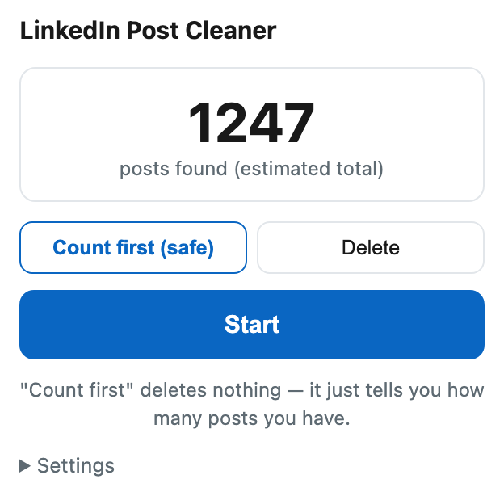

# LinkedIn Post Cleaner

**LinkedIn gönderilerini topluca sil — ve listenin gerçekten sonuna kadar git.**

Diğer araçlar ~500 gönderide durup "bitti" diyor.
Bu araç sayfayı yenileyip devam ediyor, çünkü işe yarayan tek yol bu.

Önce say modu — sen modu değiştirmeden hiçbir şey silinmez.

---

## Sorun

Profilini temizlemek istiyorsun. LinkedIn toplu silme vermiyor — bir gönderi, üç
tıklama, bir onay penceresi; bin kere.

Bir script buluyorsun. Çalışıyor, birkaç yüz gönderi siliyor, **bitti** diyor.
Profilini yeniliyorsun; yüzlerce gönderi hâlâ duruyor.

Script yalan söylemiyordu. **LinkedIn, yaklaşık 400–500 gönderiden sonra listeye
yeni öğe beslemeyi bırakıyor.** Ne kadar aşağı kaydırırsan kaydır yenisi gelmiyor.
Sayfayı izleyen her şey, haklı olarak "bitti" sonucuna varıyor.

Gerçek bir hesapta ölçüldü: sayfa **37 gönderi kaldı** diyordu. Yeniledikten
sonra **481** gönderi daha çıktı.

## Çözüm

Sayfayı yenile ve devam et. Basit görünüyor, ama bedeli şu: **yenileme, işi yapan
script'i öldürür.** Konsola yapıştırılan bir kod kendi sayfa yenilemesinden sağ
çıkamaz — internetteki bütün "konsola şunu yapıştır" araçlarının hatası tam olarak
budur.

Bu yüzden bu bir eklenti. İlerleme `chrome.storage`'da duruyor, sekme her 50
gönderide kendini yeniliyor ve içerik script'i her sayfa açılışında kaldığı
yerden devam ediyor.

**Canlı bir hesapta kanıtlandı: tek gecede 1.200'den fazla gönderi silindi.**

## Kurulum

Chrome Mağazası'nda henüz yok. Yarım dakika sürüyor:

1. **[ZIP'i indir](https://github.com/ekremmertu/delete-all-linkedin-posts/archive/refs/heads/main.zip)** ve zip'ten çıkar.
2. `chrome://extensions` adresini aç (Brave: `brave://extensions`, Edge: `edge://extensions`).
3. Sağ üstten **Geliştirici modu**'nu aç.
4. **Paketlenmemiş öğe yükle** de ve çıkardığın klasörü seç.

Chrome, Brave, Edge ve diğer Chromium tarayıcılarda çalışır.

## Kullanım

1. Kendi gönderiler sayfana git: `linkedin.com/in/<sen>/recent-activity/all/`
2. Eklenti simgesine tıkla.
3. **Önce say** modunda bırak, **Başlat**'a bas. Hiçbir şey silinmez — sadece
   gerçekten kaç gönderin olduğunu söyler.
4. Sayı doğruysa **Sil** moduna geç ve tekrar **Başlat**'a bas.

Sekme her 50 gönderide kendini yeniler; bu normaldir, kapatma.
**Durdur**, sıradaki gönderide devreye girer.

Hız: gönderi başına **8–11 saniye**. Bin gönderi birkaç saat sürer. Bu yavaşlık
bilerek: siteye yüklenmek hem kabalık hem de hız sınırına takılmanın kestirme yolu.

> [!WARNING]
> **Silinen geri gelmez.** LinkedIn'de çöp kutusu yok, geri alma yok.
> Metinler lazım olabilirse önce yedek al:
> Ayarlar → Veri gizliliği → *Verilerinin bir kopyasını al*.

## Farkı ne

| | Alışılmış araç | Bu |
|---|---|---|
| Listeyi tazelemek için yenileme | ✗ | ✓ her 50 gönderide |
| Yenilemeden sonra devam | ✗ | ✓ durum `chrome.storage`'da |
| Türkçe/yabancı arayüz | ✗ sadece "Delete" arar | ✓ dil bağımsız CSS sınıfı, metin sadece yedek |
| Prova modu | bazen | ✓ **varsayılan açık** — silmeden önce sayar |
| Silmeden önce sayma | ✗ | ✓ LinkedIn'in kendi çizim numarasını okur |
| Durdur düğmesi | bazen | ✓ sıradaki gönderide durur |

Dil meselesi göründüğünden önemli: `"Delete"` kelimesini arayan bir araç, Türkçe
arayüzde **tek bir gönderi bile** silemez. Bu araç her dilde aynı olan
`li.option-delete` sınıfını kullanıyor, metne ancak o sınıf değişirse düşüyor.

## Hiçbir şeye dokunmadan saymak

Sayfadaki kartları saymak **eksik sayar**. LinkedIn kartları geri dönüştürüyor:
sen aşağı kaydırdıkça eskileri hafızadan atıyor, ne kadar gidersen git sayfada
hep birkaç yüz kart kalıyor.

Kartın üzerindeki görünmez etiket ise atılmıyor. LinkedIn çizdiği her karta
*"Akış gönderi numarası N"* damgasını vuruyor ve N, sayfa açık kaldığı sürece
büyümeye devam ediyor. Gerçek bir hesapta DOM'da **452** kart varken etiketler
çoktan **965**'e ulaşmıştı — etiketler, DOM'un unuttuğunu hatırlıyordu.

**Önce say** modu sona kadar kaydırıyor, en büyük N büyümeyi bırakana kadar
bekliyor ve onu söylüyor. Bu bir **tahmin**, garanti değil: N yalnızca LinkedIn'in
bu sayfaya gerçekten verdiklerini sayar; akış beslemeyi bırakırsa —yukarıya bak—
gerçek toplam daha yüksek olabilir. Hiçbir yere tıklamadığı için önce bunu
çalıştırmanın maliyeti sıfır.

## Gizlilik

Sunucu yok, analitik yok, kendi ağ isteği yok. Hiçbir şey tarayıcından çıkmıyor.
İzinler yalnızca `storage` (yenilemeler arasında ilerlemeyi hatırlamak için) ve
`tabs` (gönderiler sayfasını yenilemek için), sadece `linkedin.com` kapsamında.

Bu araç kendi tarayıcında, kendi hesabında, normal arayüzü kullanarak tıklama
yapar. Başkasının içeriğine dokunmaz, LinkedIn'in iç API'lerini kullanmaz. Yine de
LinkedIn kullanıcı sözleşmesi otomasyon araçlarına izin vermiyor; kendi hesabında
kendi sorumluluğunda kullanırsın.

## Durum

- **Silme motoru denenmiş.** `content.js` içindeki seçiciler ve tıklama sırası,
  canlı bir hesapta tek gecede 1.200'den fazla gerçek gönderi silen kodun aynısı.
  "Her N gönderide yenile" ve "üç boş turdan sonra bitti say" kuralları da o
  koşudan çıktı.
- **Eklenti kabuğu motordan daha genç.** Açılır pencere, `chrome.storage` durumu
  ve yenilemeden sonra devam etme yolu çok daha az yol kat etti. Bir aksilik
  çıkacaksa silme kısmında değil, burada çıkar.
- **Sil**'den önce her zaman **Önce say**'ı çalıştır. Hiçbir şeye dokunmaz ve
  eklentinin gönderilerini görüp göremediğini sana söyler.

## Nasıl çalışıyor

- **`content.js`** — her gönderinin "…" düğmesini bulur, menüyü açar, silme
  satırına tıklar, penceredeki onayı verir, tekrarlar. Her N gönderide durumu
  kaydedip yeniler. Açılışta devam eden bir koşu var mı bakar ve sürdürür. Sayfa
  boş gelirse yenileyip tekrar bakar; ancak üç boş turdan sonra işi bitmiş sayar.
- **`popup.js`** — ayarlar ve ilerleme. Durum, `chrome.storage.local` içinde tek
  bir nesne; böylece açılır pencere ile sayfa hep aynı şeyi söyler.

## Bozulursa

LinkedIn zaman zaman işaretlemesini değiştiriyor ve bu er ya da geç burayı bozar.
Bakılacak seçiciler `content.js` içindeki `MENU_SECICI`, `silSatiri()` ve
`onayDugmesi()` — üçü de önce sabit bir CSS sınıfı dener, sonra metne düşer.

Tarayıcını, LinkedIn arayüz dilini ve açılır pencerede ne gördüğünü yazarak issue
aç. Pull request'ler açık — [CONTRIBUTING.md](CONTRIBUTING.md).

---

MIT lisanslı · [English README](README.md)
